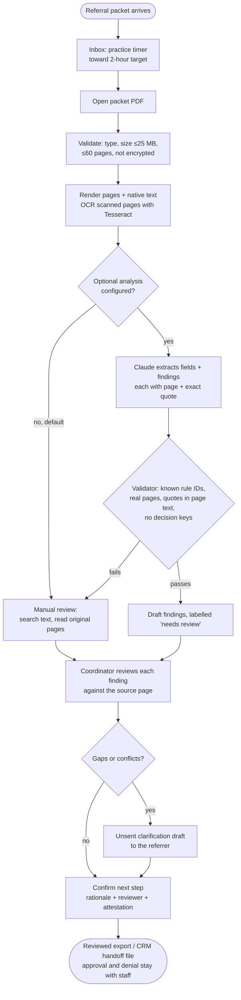
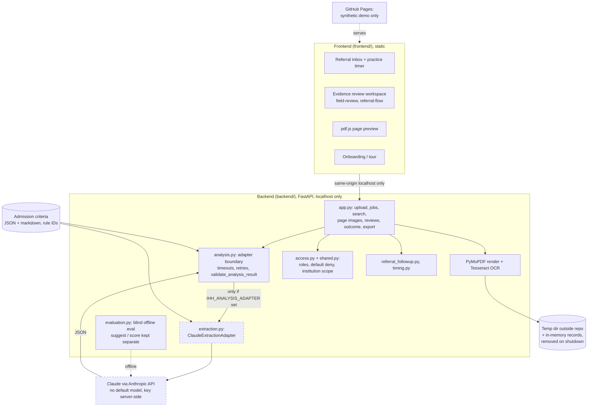
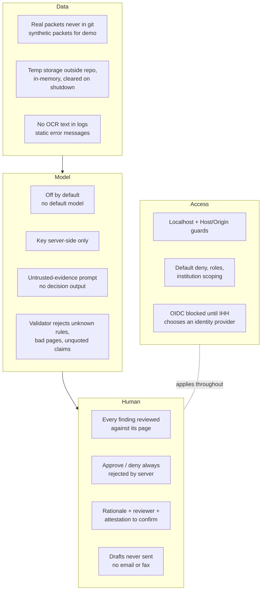

# Referral Review Assistant: architecture, workflow and safety

**Challenge 1: Referral intake.** For the referral coordinator at Illumination Health + Home (IHH).
The app inside is **Careward**, built by Team 1 (Aaron Zendejas, Harjeev, Vibhu Arya, Neetal).

## 1. High level

Hospitals send referral packets by fax and email all day: a referral form plus pages of chart. The
coordinator must read each packet against IHH's admission criteria and answer within a two-hour
target: yes, no with a reason, or a list of what is missing. The form is one person's summary and
can be wrong, so the chart must be checked too.

Referral Review Assistant turns a packet into **searchable, page-linked evidence**, lines each
finding up with an admission rule and the exact page it came from, surfaces conflicts and unknowns,
and drafts a clarification request. **The coordinator decides; the tool never approves or denies.**

| | |
|---|---|
| **User** | IHH referral coordinator (intake staff) |
| **Input** | A referral packet PDF, often an image-only fax |
| **Output** | Page-linked findings per admission rule (meets / unmet / unknown / conflict / clinical review), open questions for the referrer, an unsent clarification draft, a reviewed export |
| **AI** | OCR (Tesseract) by default; optional Claude extraction behind a strict validation boundary, **off by default** |
| **Runs** | Static demo on GitHub Pages (synthetic referrals); full processing on a local FastAPI service |

## 2. Workflow

## 3. Architecture

Dashed boxes are optional and off unless explicitly configured.

**Where AI is used, and where it isn't**

| Component | Technology | AI? |
|---|---|---|
| Text from scanned faxes | Tesseract OCR via PyMuPDF page renders | Machine learning (OCR) |
| Field and finding extraction | Claude, one JSON object per packet, prompt `extract-draft-1`, admission rule IDs only | **LLM, optional, off by default** |
| Validating model output | `validate_analysis_result`: schema, known rule IDs, page ranges, quotes present in page text, no decision keys | No |
| Offline evaluation | `evaluation.py suggest` (model) and `score` (no model, only part that reads historical labels) | LLM in `suggest` only |
| Search, review, versioning, guards, export | Deterministic Python and JavaScript | No |
| Admit / deny | The coordinator | Human |

## 4. How it was implemented

- **Team build at the Orange County Claude Impact Lab (October 17, 2026),** with Claude and other
  coding assistants, split into backend tickets (BE-01 to BE-06, LOOP-05/06) and frontend lanes.
- **Frontend:** vanilla JavaScript modules, pdf.js for page preview, synthetic referral packets for
  practice, an allowlisted static build deployed to GitHub Pages after 34 frontend tests pass.
- **Backend:** FastAPI + PyMuPDF + Tesseract, pinned dependencies, one processing worker, bounded
  pages, OCR time and text length; versioned reviews where stale writes are rejected.
- **LLM boundary:** the adapter module is found but not executed at startup; the Claude client is
  built only on the inference path; per-call timeout and bounded retries; any invalid, untraceable
  or decision-style output becomes `failed`, never a result. Page text is wrapped as untrusted
  evidence and the model is told to ignore instructions inside it.
- **Evaluation:** blind and reproducible. `suggest` never opens the labels file; results are cached
  by packet, criteria, prompt, model and schema hash; agreement with past decisions is explicitly
  not called accuracy.
- **Tests:** 156 backend tests (with subtests) and 34 frontend tests, all invented data.

## 5. Governance and safety

| Risk | Control |
|---|---|
| Admitting someone the site can't safely care for, or turning away someone who needed the bed | The tool never decides: the server rejects approve/deny in this version; every finding links to a page and quote; missing or redacted evidence is "unknown", never "meets"; conflicts are shown, not resolved silently; internal criteria take precedence over the referral form |
| Being blamed for a machine's mistake | AI output is labelled draft and "needs review"; confirmation requires rationale, reviewer label and attestation; editing a field invalidates the earlier confirmation |
| Patient privacy | Real referral packets never committed (CI checks the deploy contains only allowlisted synthetic files); processing on localhost only; temp files outside the repo; no OCR text in logs; data not durable |
| Model invents evidence | Quotes must appear in the page text; pages must exist; rule IDs must be real; failures become `failed`, not results |
| Prompt injection from packet text | Page text is wrapped as untrusted evidence; instructions inside it are ignored |
| Secrets | `ANTHROPIC_API_KEY` server-side only, never in git, issues, PRs or the frontend; `.env` git-ignored |
| Overclaiming | Practice timer is illustrative, not a service deadline; no measured time savings; agreement with historical labels is not accuracy |
| Access | Shared-record service off without identity; dev sessions are rehearsal-only; OIDC blocked until IHH decides |

**Known limits.** The model-backed extractor targets a draft contract and is not tested against a
real model. OCR orientation, handwriting and checkbox accuracy are outstanding. There is no
production authentication, durable audit or compliance certification. The follow-up and
shared-record modules are tested but not yet wired into one persistent frontend workflow.
